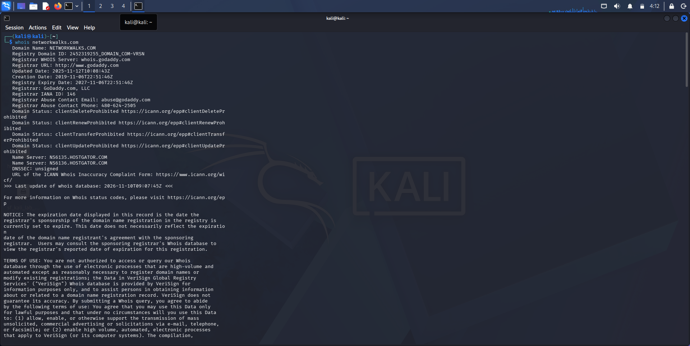
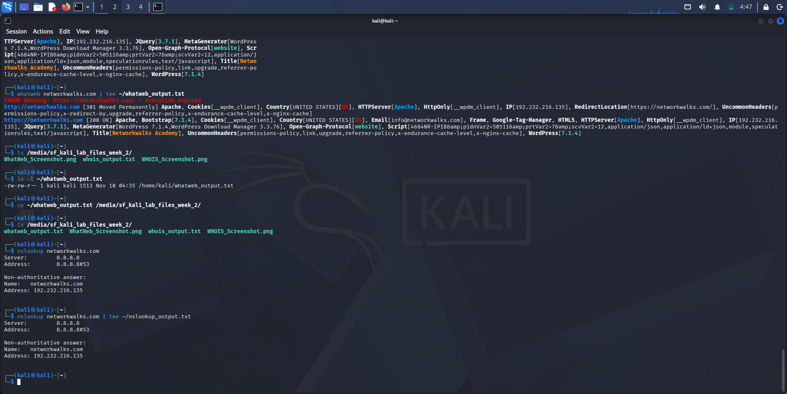
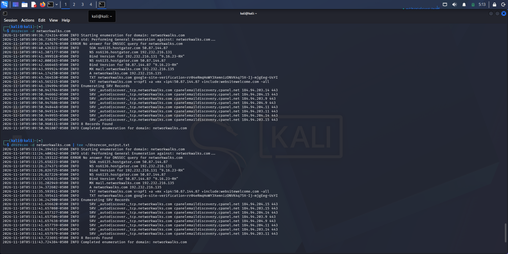
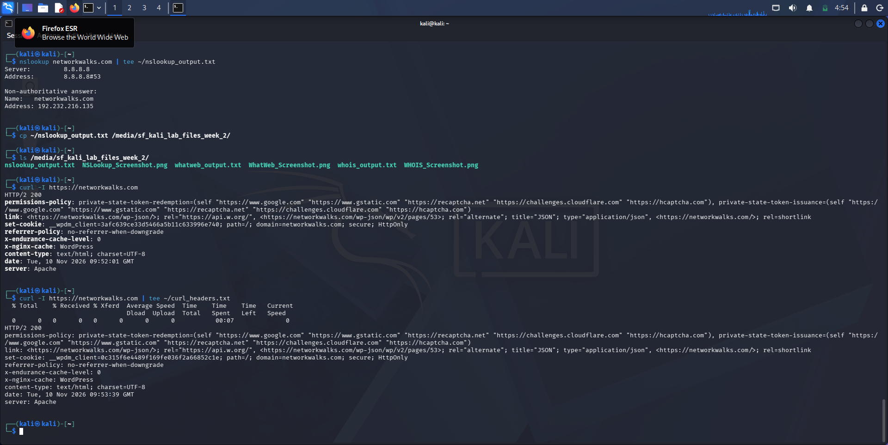
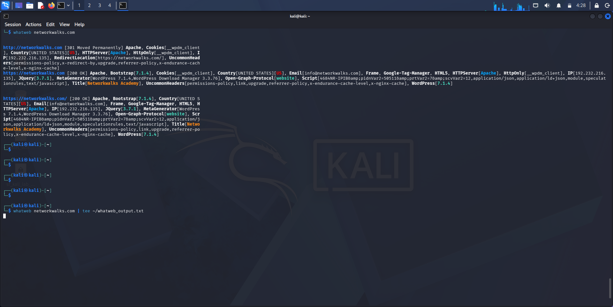
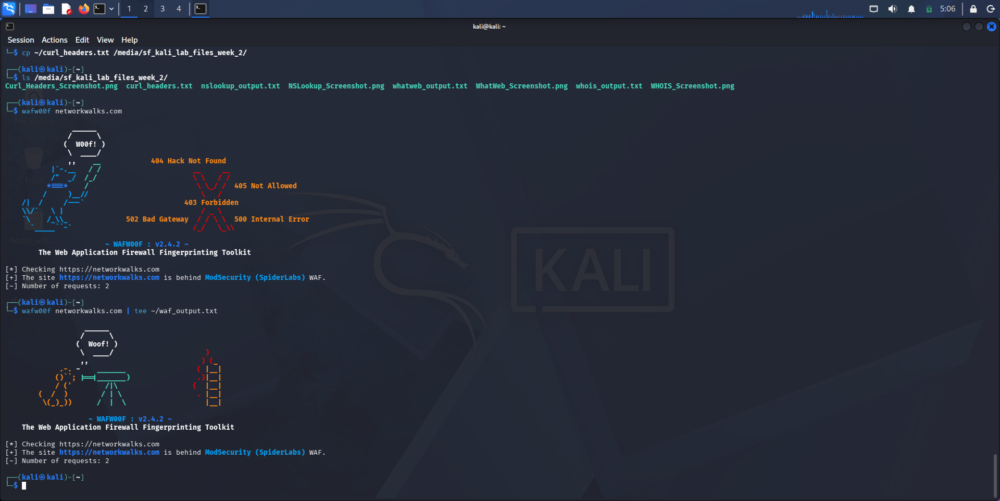
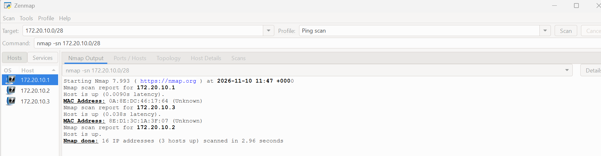

# Week 2 Cybersecurity Internship: Footprinting, Reconnaissance and Network Scanning

## Executive Summary

This project documents a structured cybersecurity internship exercise focused on ethical footprinting and reconnaissance. The objective was to assess the public digital footprint of `networkwalks.com` using publicly available information and standard reconnaissance techniques, while maintaining a responsible and non-invasive approach.

The investigation included review of WHOIS data, DNS records, HTTP response behavior, technology fingerprinting, and WAF detection. The findings indicate that the target is a live public website, that it redirects HTTP traffic to HTTPS, that it is running on a WordPress-based platform, and that an application-layer protection mechanism (ModSecurity) appears to be in place.

This repository is designed to demonstrate professional evidence collection and reporting in a cybersecurity context. It highlights how public data can be used to form a credible security profile without exploiting vulnerabilities or conducting unauthorized testing.

## Project Overview

This repository was created as part of a Week 2 cybersecurity internship task focused on footprinting, reconnaissance, and network scanning fundamentals. It provides a practical demonstration of how ethical security practitioners assess a target’s public exposure by reviewing open-source indicators and technical metadata.

The project emphasizes a disciplined methodology, careful interpretation of gathered evidence, and professional documentation. The content supports a broader understanding of how digital assets are mapped in the public domain and how cybersecurity teams use reconnaissance to identify risk areas, exposure points, and security posture.

## Objectives

The objectives of this task were to:

- identify the target domain and public-facing exposure;
- review WHOIS and DNS data for validation of domain ownership and reachability;
- inspect HTTP behavior and server responses;
- identify technologies used by the website;
- assess whether defensive controls such as a WAF appear to be present;
- document findings in a clear, evidence-based report.

## Scope and Methodology

This assessment was limited to passive reconnaissance and public information gathering. No exploit attempts, credential harvesting, unauthorized access, or destructive activity were performed.

The methodology followed a standard defensive security workflow:

1. Domain and WHOIS review
2. DNS and host resolution analysis
3. HTTP response and web server inspection
4. Technology fingerprinting
5. WAF identification
6. Documentation and reporting of findings

It is important to note that some findings were based on tool-detected indicators rather than confirmed manual verification. These results are therefore best interpreted as evidence-based observations rather than definitive proof of system configuration or vulnerability status.

## Target Summary

- Domain: `networkwalks.com`
- Assessment date: 2026-11-10
- Public IP address identified: `192.232.216.135`
- Observed web platform: WordPress-based website
- Observed server: Apache
- Observed transport behavior: HTTP to HTTPS redirect
- Observed security control: ModSecurity WAF

## Findings and Evidence

### 1. Domain Registration and WHOIS Analysis

WHOIS data confirmed that the target domain is active and registered through a major registrar. Ownership details were protected through privacy services, which is common in public-facing commercial environments.

Key observations:

- The domain is active and registered.
- Standard registrar and nameserver infrastructure are in use.
- Registrant data is masked, which is a common privacy-preserving measure.
- The domain appears to be a legitimate public website rather than a temporary or suspicious host.

Relevant output: [whois_output.txt](./whois_output.txt)

### 2. DNS Resolution and Host Discovery

DNS resolution showed that `networkwalks.com` resolves successfully to a public IPv4 address. This confirms that the target is live and reachable over the internet.

Key observations:

- The domain resolves successfully.
- Public IPv4 address: `192.232.216.135`
- Host is reachable and publicly exposed.
- The domain has a conventional DNS footprint.

Relevant output: [nslookup_output.txt](./nslookup_output.txt) and [dnsrecon_output.txt](./dnsrecon_output.txt)

### 3. HTTP Headers and Server Behavior

The web server analysis showed that requests to the site redirect from HTTP to HTTPS. The HTTPS endpoint responded successfully, and the server banner identified Apache. This is consistent with a standard configuration for a public-facing website that enforces secure transport.

Key observations:

- HTTP requests redirect to HTTPS.
- HTTPS endpoint returned a successful response.
- Server banner indicates Apache.
- The response includes common web headers and plugin-related metadata.
- The platform shows evidence of normal public web service behavior.

Relevant output: [curl_headers.txt](./curl_headers.txt)

### 4. Technology Stack Identification

Web fingerprinting identified the target as a WordPress-based website and surfaced supporting technologies such as Bootstrap and jQuery. These findings are useful in understanding the digital footprint of the target, but should be interpreted as tool-detected indicators rather than absolute confirmation of exact production configuration.

Key observations:

- Platform detected: WordPress 7.1.4
- Plugin or download manager detected: WordPress Download Manager 3.3.76
- Front-end frameworks detected: Bootstrap, jQuery
- Site metadata indicates a modern educational/public-facing site

Relevant output: [whatweb_output.txt](./whatweb_output.txt)

### 5. WAF Detection

The reconnaissance results indicated the presence of ModSecurity, which suggests that the target is protected by an application-layer firewall. While this is an encouraging sign, WAF detection alone does not guarantee complete security or perfect configuration. It does, however, indicate that the target has at least one layer of defensive filtering in place.

Key observations:

- WAF detected: ModSecurity (SpiderLabs)
- Traffic filtering is likely in place at the application layer
- Defensive controls appear to be present at the edge of the application stack

Relevant output: [waf_output.txt](./waf_output.txt)

### 6. Network Scanning and Zenmap Evidence

The repository also includes Zenmap-related evidence and supporting documentation for network scanning activities. These artifacts provide additional context for the project and reinforce the practical nature of the assessment.

.png)

Supporting document: [Nmap - Zenmap GUI.pdf](./Nmap%20-%20Zenmap%20GUI.pdf)

## Security Insights

This project highlights several important lessons in cybersecurity and ethical reconnaissance:

- Public information is often enough to build a meaningful operational picture of a target.
- DNS, HTTP, and WHOIS data can reveal a large amount of intelligence without exploitation.
- Website fingerprinting can help map the platform, frameworks, and deployment posture of a target.
- Defensive controls such as WAFs are important indicators of an organization’s security maturity.
- WordPress-based systems, when not patched or managed properly, can become a common attack surface.

The overall posture suggests a publicly reachable website with basic security controls in place. While the evidence indicates good practices such as HTTPS enforcement and a WAF, it should be interpreted carefully. The project does not confirm a complete security assessment or guarantee absence of vulnerabilities. Instead, it demonstrates how reconnaissance supports risk awareness, digital exposure analysis, and evidence-based reporting.

## Lessons Learned

This internship task reinforced several practical lessons:

- Reconnaissance is most effective when it is structured, documented, and performed within a defined scope.
- Public metadata can reveal much about an organization’s digital footprint even without direct exploitation.
- Technology detection should be interpreted carefully; scan results are informative, not definitive.
- Defensive controls matter, but they require proper configuration and regular maintenance to remain effective.
- Professional reporting is just as important as the technical findings, because stakeholders need clear evidence and context to act on results.

## Supportive Materials

The repository includes the following supporting files:

- [README.md](./README.md)
- [whois_output.txt](./whois_output.txt)
- [nslookup_output.txt](./nslookup_output.txt)
- [dnsrecon_output.txt](./dnsrecon_output.txt)
- [curl_headers.txt](./curl_headers.txt)
- [whatweb_output.txt](./whatweb_output.txt)
- [waf_output.txt](./waf_output.txt)
- [Nmap - Zenmap GUI.pdf](./Nmap%20-%20Zenmap%20GUI.pdf)
- [W2-PM-FINAL - Sample Report v2.docx](./W2-PM-FINAL%20-%20Sample%20Report%20v2.docx)
- [kali_lab_files_week 2.zip](https://github.com/user-attachments/files/34630745/kali_lab_files_week.2.zip)

## Conclusion

This project demonstrates a responsible and well-structured approach to passive reconnaissance in a cybersecurity context. Through the collection and analysis of WHOIS, DNS, web headers, technology fingerprints, and WAF indicators, the exercise shows how public data can be used to understand a target’s digital exposure and defendable posture.

The evidence indicates that `networkwalks.com` is a live public website with standard web infrastructure, HTTPS enforcement, and a likely application-layer security control. While this does not constitute a full vulnerability assessment, it successfully reflects the core principles of ethical cybersecurity assessment: evidence gathering, careful interpretation, and professional reporting.

This repository stands as a practical internship deliverable and a useful demonstration of how reconnaissance supports cybersecurity understanding, risk awareness, and defensive analysis.
